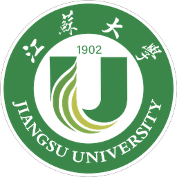

# 江苏大学生存手册

**由江大人写给江大人的非官方生存指南**

---

## 📖 在线阅读

**👉 [https://ainzfn.github.io/UJS-Survival-Guide/](https://ainzfn.github.io/UJS-Survival-Guide/)**

## 这是什么

这是由在校学生与毕业生自发编写、持续更新的经验合集。它不替你做决定，只负责把前人走过的路、踩过的坑，如实标出来。

选课怎么选、绩点怎么算、要不要转专业、保研考研出国就业怎么选、奖学金怎么评、食堂哪家好吃、镇江怎么玩——你在大学四年里会遇到的每一个岔路口，这里都有学长学姐留下的一手记录。

## 手册里有什么

| 章节 | 内容 |
|---|---|
| [认识江大](https://ainzfn.github.io/UJS-Survival-Guide/campus/) | 校园地图、常用系统、办事指南——新生第一周需要的都在这 |
| [学业生存](https://ainzfn.github.io/UJS-Survival-Guide/study/) | 选课、GPA、转专业、保研要求、评奖评优、竞赛、科研 |
| [出路](https://ainzfn.github.io/UJS-Survival-Guide/path/) | 保研 / 考研 / 出国 / 就业 / 考公等每条路的综述与真实经验帖 |
| [生活](https://ainzfn.github.io/UJS-Survival-Guide/life/) | 美食评测、宿舍园区、镇江生活、兼职避坑 |
| [附录](https://ainzfn.github.io/UJS-Survival-Guide/appendix/contributors) | 感谢贡献者、社团介绍、常见问题 |

## 这本手册的三个承诺

1. **不以出路论高下**——保研清北与就业都值得写入手册。
2. **述而有据**——批评出于亲历，政策注明出处与核实时间。
3. **凡有所赠，皆留其名**——每位投稿人均收录于[贡献者名录](https://ainzfn.github.io/UJS-Survival-Guide/appendix/contributors)。

## 🤝 参与贡献

**往仓库的[投稿箱](https://github.com/AinzFn/UJS-Survival-Guide/tree/main/inbox)里丢一个文件，就算投稿**：

1. 打开 [inbox 投稿箱文件夹](https://github.com/AinzFn/UJS-Survival-Guide/tree/main/inbox)，点 **Add file → Create new file**；
2. 文件名随意（建议「主题-昵称」），内容格式随意；
3. 提交即完成——维护者会定期整理上架，[贡献者名录](https://ainzfn.github.io/UJS-Survival-Guide/appendix/contributors)会自动留下你的名字。

详细图文步骤见[投稿教程](https://ainzfn.github.io/UJS-Survival-Guide/contribute/how-to-contribute)。

## 🙏 致谢

本手册的体例与精神深受 [《上海交通大学生存手册》](https://github.com/SurviveSJTU/SurviveSJTUManual)（2008）及南方科技大学、南京理工大学、合肥工业大学等各校同类项目启发，向这些学校的同学们致谢。

## ⚠️ 声明

本手册为在校学生自发组织的**非官方**项目，与江苏大学官方无关；政策类信息具有时效性，一切以学校最新正式文件为准。正文内容采用 [CC BY-NC-SA 4.0](LICENSE-CONTENT.md) 协议，站点代码采用 [MIT](LICENSE) 协议。

**纸短指引，前路自觅。**

